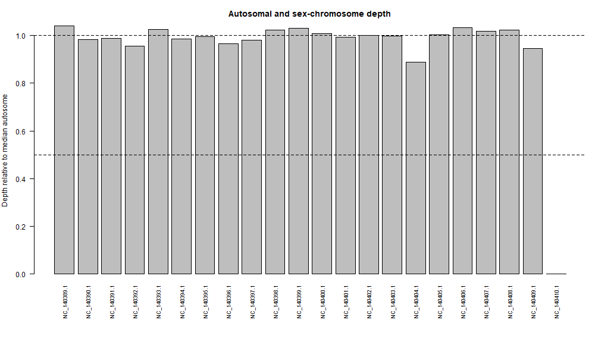

# Sex-Chromosome Dosage Analysis in Postman Butterfly (Heliconius melpomene)

## Overview
This repository contains a sequence read-depth analysis to estimate the sex-chromosome dosage complement of a selected animal nuclear genome using whole-genome shotgun (WGS) DNA reads mapped with Galaxy and processed in R.

* **Student:** Bullanday, Jasmin Grace T.
* **Section:** B
* **Course:** Cell and Molecular Biology Lab

---

## Data Accessions & Metadata

* **Species:** Postman Butterfly (*Heliconius melpomene*)
* **Assembly Accession:** GCF_056956725.1
* **Assembly Name:** ASM5695672v1
* **Assembly BioSample:** SAMN53245282
* **Sex System:** ZW
* **WGS Run Accession:** ERR12331306
* **WGS BioSample:** SAMEA114725234
* **Same Donor?:** No

---

## Workflow & Methods

1. **Data Retrieval:** Retrieved reference FASTA (`GCF_056956725.1`) and sequence report from NCBI Datasets, and WGS FASTQ reads (`ERR12331306`) from NCBI SRA.
2. **Read Alignment (Galaxy):** 
   * Assessed quality via FastQC.
   * Aligned reads to the reference assembly using BWA-MEM in Galaxy.
   * Filtered mapping quality and calculated coverage using `Samtools coverage` (minimum mapping quality = 20, minimum base quality = 20) to generate `chromosome_coverage.tsv`.
3. **Dosage Analysis (R):**
   * Classified 21 autosomes as `A` and the Z/W sex chromosomes (`NC_140409.1` and `NC_140410.1`) in `chromosome_groups.csv`.
   * Executed `sex_depth_analysis.R` to compute relative depths against the median autosome depth.

---

## Results & Figures

* **Median Autosomal Depth:** 20.398
* **Z / A Ratio:** 0.947
* **W / A Ratio:** 0
* **Inferred Sex-Chromosome Dosage:** **ZZ-like** (Homogametic Male)

### Relative Depth Figure


---

## Study Questions & Answers

### 1. Species Choice & Sex Determination System
The Postman Butterfly (*Heliconius melpomene*) was chosen. It is a normally diploid insect with an established ZZ/ZW sex determination system, which is verified by annotated Z and W sex chromosomes in the NCBI chromosome-level assembly report.

### 2. Accessions & Donor Metadata
* **Assembly Accession:** GCF_056956725.1 (BioSample: SAMN53245282)
* **WGS Run Accession:** ERR12331306 (BioSample: SAMEA114725234)
* **Donor Relationship:** **No**, the genome assembly donor and the WGS read donor are different individuals. Consequently, our read-depth inference reflects the sex of the WGS read donor rather than the assembly donor.

### 3. Chromosome Group Selection & Verification
* **Autosomes ($A$):** 21 autosomes (`NC_140389.1` through `NC_140408.1`).
* **Sex Chromosomes:** `NC_140409.1` (Z) and `NC_140410.1` (W).
* Identities were verified using the NCBI chromosome sequence report, ensuring unplaced scaffolds, alternate haplotypes, and mitochondrial DNA were excluded from the autosome set.

### 4. Summary of Coverage Metrics
* Median autosomal coverage depth: **20.398**
* Z:A coverage ratio: **0.947**
* W:A coverage ratio: **0**
* Inferred complement: **ZZ-like**

### 5. Metadata Comparison & Discrepancies
The inferred **ZZ-like** complement indicates a homogametic male. This is validated by comparing it against the recorded sex metadata of the WGS read donor. Any minor variance from an exact 1.0 ratio can be attributed to sequencing noise, repetitive elements, or mapping biases.

### 6. Assembly Limitations
A chromosome-level assembly alone only details sequence layout and chromosome lengths, lacking individual-specific read abundance data. Read-depth dosage analysis requires mapping actual whole-genome sequencing reads to account for real-world biological variation, repeat regions, and copy number differences that static assembly files cannot capture.

---

## Repository Structure

```text
├── chromosome_coverage.tsv
├── chromosome_groups.csv
├── sex_depth_analysis.R
├── README.md
└── results/
    ├── chromosome_relative_depth.csv
    ├── chromosome_depth.png
    └── sex_inference.txt
